# 旅迹智绘 · Travel-agents

**旅迹智绘** 是一个基于 **LangGraph 多智能体工作流** 的 AI 旅行规划系统。你可以翻开手账选一座城、写下日期与偏好，也可以先和 AI 聊聊想法；确认之后，Agent 会并行调用高德地图 MCP、12306 MCP 与本地知识库，拿到真实的景点、酒店、天气与车次数据，再通过「规划 → 评估 → 反思修订」循环，生成一份包含每日行程、餐饮、住宿与预算的完整旅行计划，并通过 SSE 实时推送生成进度。

## 📸 界面预览

| 首页 · 把一座城写成一页旅程 | 首页 · 快速开始 / AI 对话两种入口 |
| :---: | :---: |
|  |  |

| 快速开始 · 手账翻书选城 | 翻页动画 · 切换到下一座城 |
| :---: | :---: |
|  |  |

| 快速开始 · 填写日期与偏好 | AI 对话 · 边聊边定行程 |
| :---: | :---: |
|  | 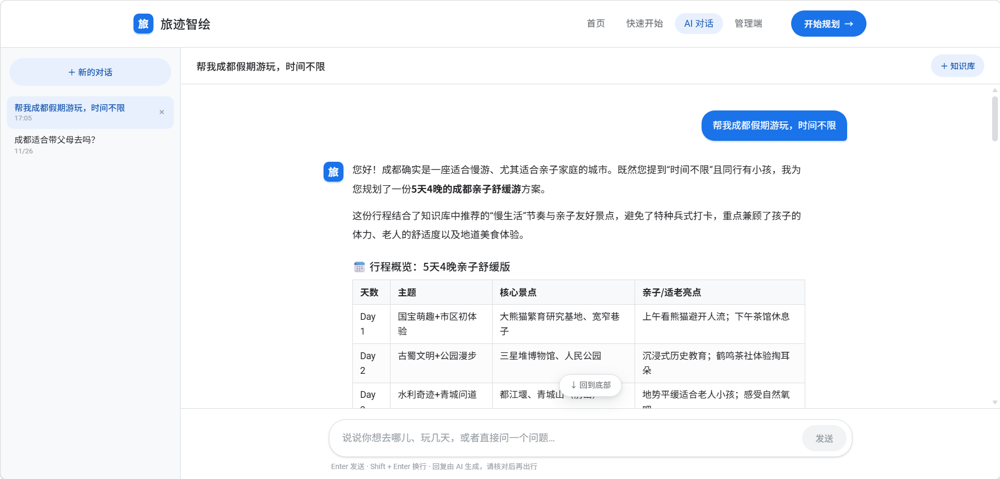 |

| 对话 · 自动整理偏好 | 对话偏好 · 一键带入快速开始 |
| :---: | :---: |
| 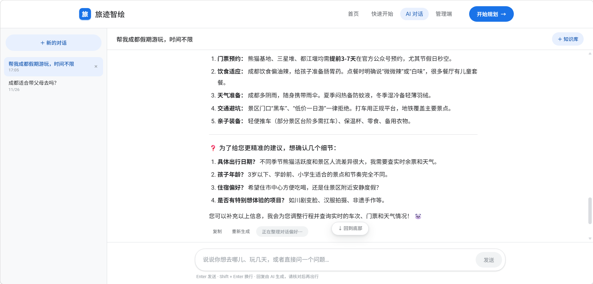 |  |

| 知识库 · 上传自己的攻略 | 知识库 · 已上传资料 |
| :---: | :---: |
| 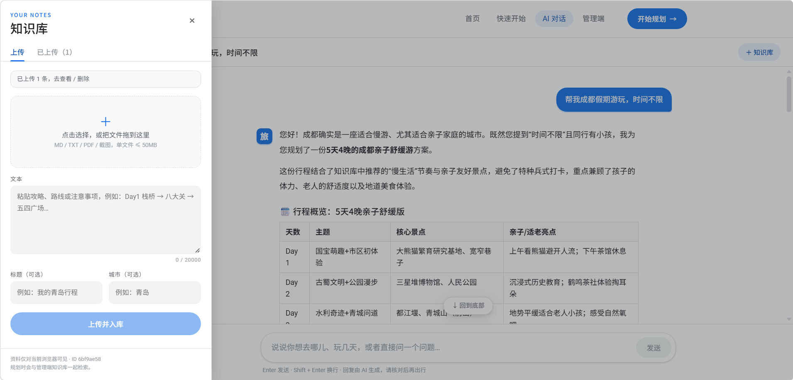 | 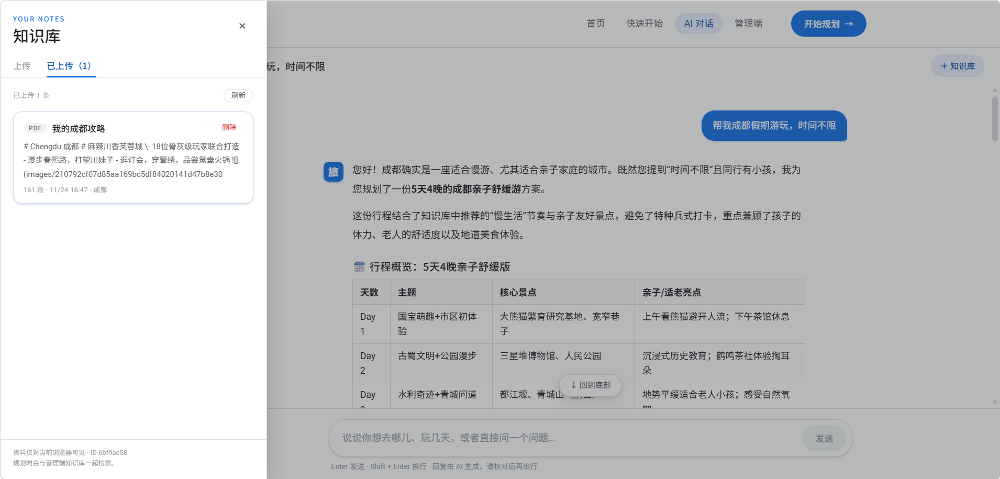 |

| 规划进度 · SSE 实时反馈 | 规划结果 · 登机牌概览 |
| :---: | :---: |
| 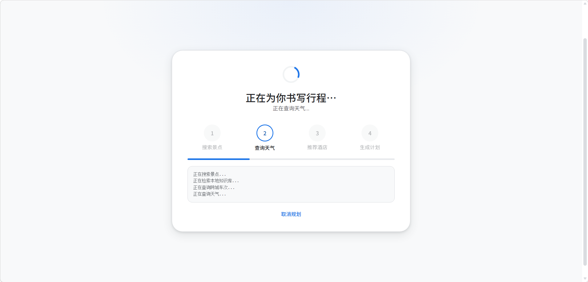 | 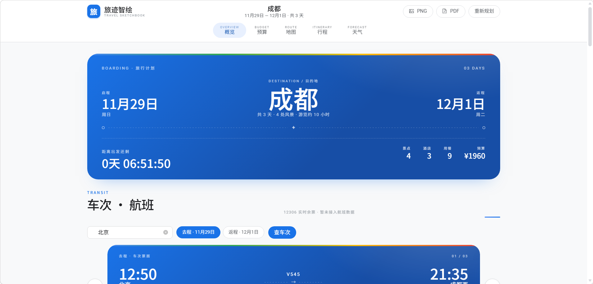 |

| 车次票面 · 左右滑动切换 | 行程概览 · 适老 / 亲子建议 |
| :---: | :---: |
| 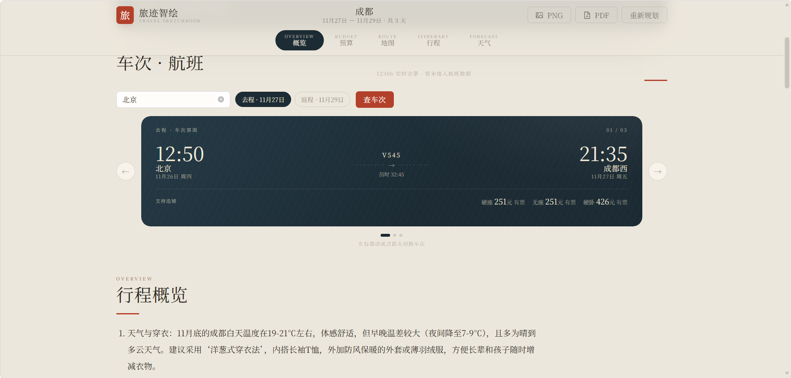 | 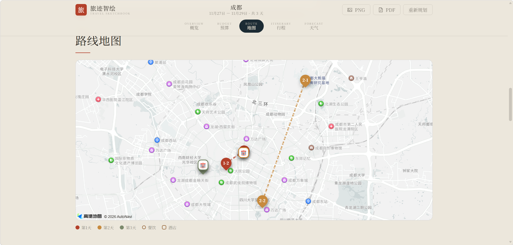 |

| 预算明细 · 分项与总计 | 路线地图 · 按天连线 |
| :---: | :---: |
| 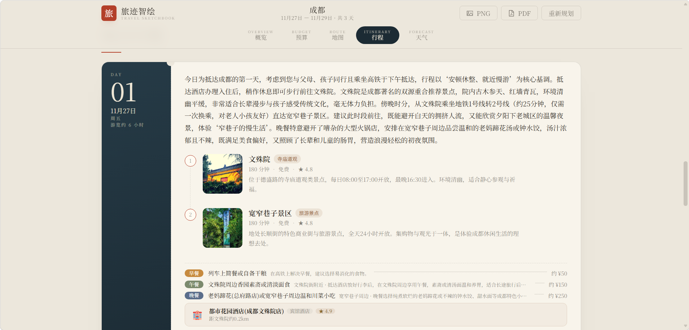 | 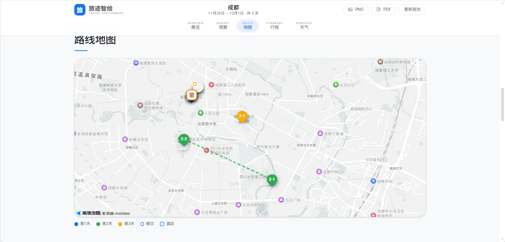 |

| 每日行程 · 时间线 | 天气信息 · 逐日预报 |
| :---: | :---: |
|  | 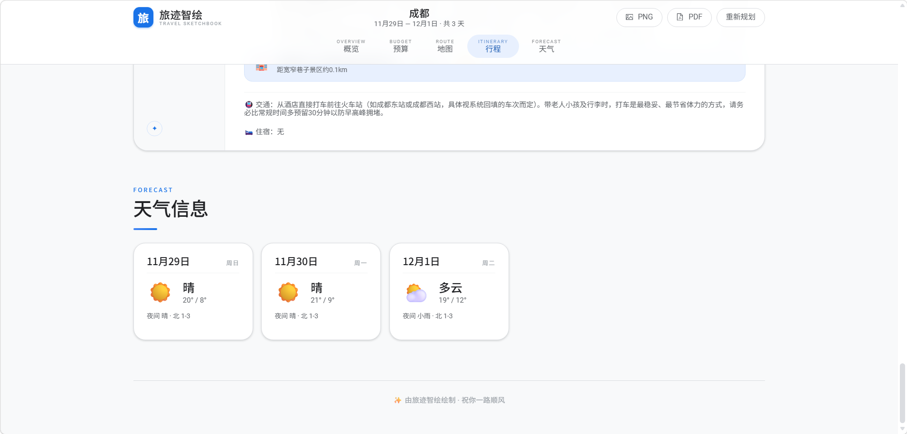 |

## ✨ 功能特性

### 🗺 站点与入口

- **沉浸式首页**：牛皮纸手账视觉、叠放的旅行明信片与热门城市直达入口，一眼看清「快速开始」和「AI 对话」两种开始方式。
- **快速开始**：11 座城市（北京 / 上海 / 广州 / 杭州 / 西安 / 成都 / 重庆 / 长沙 / 青岛 / 厦门 / 南京）配手绘城市插画，纯 CSS 3D + `requestAnimationFrame` 弹簧动画实现真实翻书效果，支持拖拽、键盘与点击城市直达。
- **AI 对话**：像聊天一样说出目的地、天数、同行人和偏好，支持多会话管理、流式回复、停止、重新生成与断线续传；内置意图路由、安全围栏与分层记忆，能记住你的偏好和已经聊定的行程细节。会话元数据存 PostgreSQL，消息原文由 LangGraph checkpointer 保存（`thread_id = session_id`）；内置时间与 12306 MCP 工具，可直接问「今天几号」「北京到上海明天的高铁」；聊清楚之后可一键带着已确定的信息进入快速开始。
- **跨入口衔接**：首页城市链接、对话页整理出的城市与偏好都会自动预填到快速开始表单，生成完成后再进入结果页，全程不需要重复填写。

### ✍️ 规划与结果

- **SSE 实时进度**：生成过程中以「正在为你书写行程…」进度面板展示节点级进度、步骤打勾与日志流，心跳保活，随时可以取消。
- **结果概览**：城市、日期、天数、天气与预算总览，门票 / 酒店 / 餐饮 / 交通分项明细。
- **路线地图**：高德地图 JS API 2.0 渲染，景点、酒店、餐饮分色标注，并按天绘制景点连线。
- **每日行程**：时间线展示每天的景点、餐饮、住宿与天气，景点可排序、删除后重新计算。
- **行程导出**：一键导出 PDF / PNG，方便保存与分享。

### 📚 知识库

- **上传自己的旅行资料**：支持粘贴文本，或上传 **MD / TXT / PDF / 图片（PNG / JPG / WEBP）**；PDF 走 MinerU 云端 Precision API（默认开启 OCR），图片经 Qwen-VL 转写为 Markdown，再由快模型统一整理 Markdown 排版。
- **资料管理**：查看已上传资料的标题、预览、父块 / 子块数量与城市，可随时删除；重复内容按内容指纹自动去重。
- **隐私隔离**：上传内容按浏览器匿名 `user_id` 隔离，只有自己能看到和检索。
- **结构感知父子块**：Markdown 按 H1/H2 分父块、按 H3 与表格 / 路线 / 段落切子块；子块共享「文档标题 + 章节」信息，表格逐行保留表头，`A→B→C` 路线行保持完整。
- **Milvus 混合检索**：子块写入 Milvus（id / 元数据 / 原始文本 / 稠密向量 / BM25 稀疏向量），查询时稠密与关键词多路召回 + Cross-Encoder 精排；命中子块后按 `parent_id` 回查 PostgreSQL 父块加入提示词。
- **参与规划**：生成行程时，当前城市的官方攻略语料与你上传的资料会一起被检索；检索出的必玩景点若未被地图工具覆盖，会自动触发补搜。AI 对话也可通过 `search_knowledge` 工具查询知识库。

### 🤖 Agent 能力

- **多源并行检索**：景点搜索、天气查询、RAG 知识库检索三路并行，景点详情并发拉取（信号量限流 + 自动重试）。
- **HyDE + 混合检索**：LLM 先生成假设性答案文档，再走 Milvus 稠密向量 + BM25 稀疏向量多路召回、条件过滤与 Cross-Encoder 精排；检索出的景点名未被工具覆盖时自动补搜。
- **真实数据锚点选酒店**：以景点坐标为锚点做周边 3km 酒店搜索，用 Haversine 公式计算「距景点约 X km」。
- **门控汇聚**：`plan_gate_node` 统一汇聚并行分支，景点 / 酒店 / 天气 / 知识库数据齐备后才放行规划，避免中间态提前规划。
- **评估反思循环**：评估节点先做确定性硬校验（天数、每日景点、游览总时长、住宿），再交给 LLM 做合理性评估；不合格打回规划节点修订，最多 2 轮。
- **防幻觉设计**：LLM 只输出计划框架与名称引用，景点、酒店、天气、日期等详情由系统按名称从原始数据确定性回填；未知名称跳过，空景点日按关键词或评分兜底。

## 🏗 系统架构

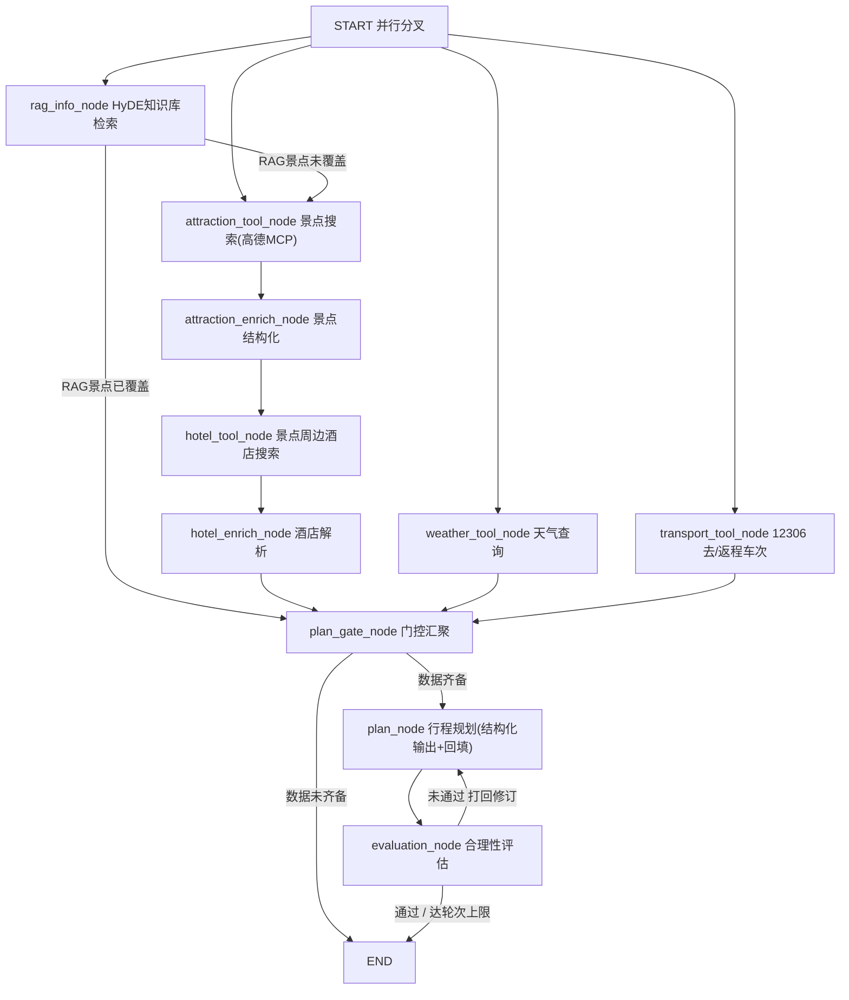

**关键设计**：

- **门控节点** `plan_gate_node`：景点 / 酒店 / 天气 / 知识库 / 车次分支全部汇聚到此，通过 `is_plan_ready()` 判定景点、酒店、天气与知识库齐备后才放行规划；未齐备时本轮直接 END，剩余分支完成后会再次触发门控。车次查询失败只降级为空，不阻断规划。
- **状态 reducer**：景点名 / 知识库景点名使用集合并集，检索结果、酒店结果、历史计划等使用列表累加，支持多轮补搜与修订叠加而不是覆盖。
- **知识库过滤下推**：城市语料与用户上传资料在 Milvus 检索阶段就按 `scope / city / owner_id` 过滤，避免把其他城市的资料或他人的私有资料带进规划。
- **可靠性**：关键节点（RAG / 规划 / 评估 / 景点结构化）配置 `RetryPolicy` 应对 LLM 偶发失败；结构化输出失败时回退到确定性模板。

## 💬 AI 对话链路

对话也是一张 LangGraph 工作流（`backend/app/modules/chat/workflow/`），`thread_id = session_id`。每一轮依次经过「加载记忆 → 意图路由 → 业务工作流 → 安全复核 → 异步写记忆」：

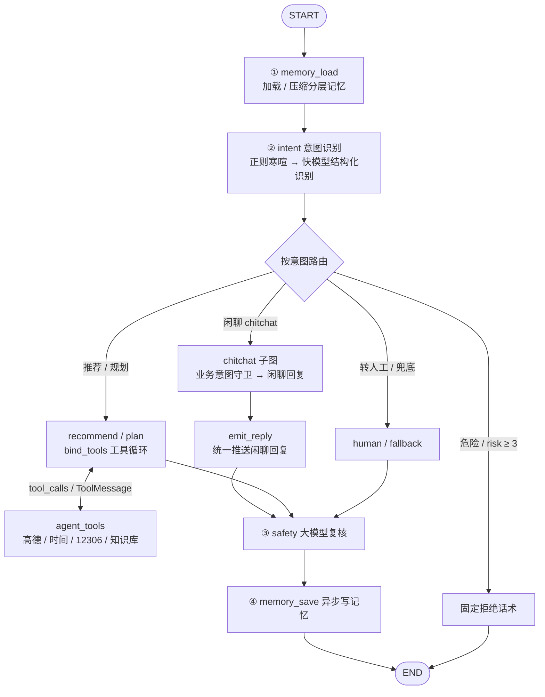

**链路要点**：

- **分层记忆**：`memory_load` 在轮首加载最近 5 轮工作记忆、会话滚动摘要、已确认 / 待确认事实、任务状态与长期记忆 top-k；`memory_save` 在轮末把记忆写入挂到后台任务，绝不阻塞 `done` 事件。记忆读写失败时降级为无记忆继续对话。
- **意图路由**：寒暄正则命中时直接回复并跳到安全复核；其余请求让快模型以 `with_structured_output(IntentResult)` 输出 `intent / reason / risk_level`，再按意图进入四类分支。识别失败走兜底，`dangerous` 或 `risk_level ≥ 3` 直接返回固定拒绝话术，不进入任何业务工作流。
- **工具循环**：推荐 / 规划节点不再使用 `create_agent`，而是用 `llm.bind_tools()` 流式作答；有 `tool_calls` 就进入 `agent_tools` 按工具名执行并回写 `ToolMessage`（失败也回写错误文本），再回到 `activated_workflow` 对应的节点。达到 `CHAT_MAX_TOOL_ROUNDS` 后改用未绑定工具的主模型强制作答，避免悬空工具调用。
- **闲聊子图**：`chitchat_guard` 检测到业务意图时通过 `Command.PARENT` 跳回 `plan` / `recommend`；子图的 custom 事件不会传回父图，回复先写入 `pending_reply`，由父图 `emit_reply` 统一推送。
- **统一收尾**：除危险请求直接 `END` 外，所有回复都汇入 `safety` 大模型复核（可用 `CHAT_SAFETY_LLM_ENABLED` 关闭），不安全时撤回并替换，再进入 `memory_save` 异步写记忆后结束。
- **流式与续传**：`POST /api/v1/chat/stream` 以 SSE 推送 `token` / `done` / `error`，生成在后台任务执行；客户端断开只停止订阅，可通过 `POST /api/v1/chat/resume` 按已收 Unicode 码点偏移补发，或 `POST /api/v1/chat/cancel` 终止生成并保留已生成文本。每次调用模型前都会剔除未配对的工具调用，避免上游 400。

## 🛠 技术栈

| 层 | 技术 |
|---|---|
| Agent 编排 | LangGraph 1.x、LangChain 1.x |
| 大模型 | LangChain `init_chat_model`（OpenAI 兼容接口，默认阿里云百炼 DashScope 通义千问，可替换任意兼容模型） |
| 工具接入 | 高德地图 MCP（SSE）、时间 MCP（stdio）、12306 MCP（stdio） |
| RAG | Milvus 3.x（稠密向量 + BM25 稀疏向量 + Cross-Encoder 精排）、PostgreSQL 父块、HyDE |
| 记忆 | PostgreSQL 情景记忆（滚动摘要 / 事实 / 任务状态）+ Milvus `user_memories` 长期记忆 |
| 缓存 | Redis 8.x（工具结果 / 会话历史 / 检索结果，TTL 60s，故障降级直通） |
| 知识库解析 | MinerU 云端 Precision API（OCR）、Markdown / TXT、pypdf、DashScope Qwen-VL 图片转写、LLM Markdown 排版优化 |
| 后端 | FastAPI、Uvicorn、SSE（`astream_events`）、pydantic-settings、AsyncPostgresSaver |
| 前端 | Vue 3、Vue Router、Vite、TypeScript、Ant Design Vue、高德地图 JS API 2.0、jspdf / html2canvas、CSS 3D 翻书动效 |
| 可观测 | Prometheus `/metrics` + 管理端看板（LLM 延迟 / token、缓存命中、精排熔断、节点与工具耗时） |
| 评测 | 检索评测（Recall / MRR / nDCG、分类型、HyDE 消融）+ 对话意图评测（80 条） |

## 🚀 快速开始

### 环境要求

- Python ≥ 3.11
- Node.js ≥ 18
- Docker Desktop（Milvus / Redis 容器）与 PostgreSQL
- 高德开放平台 API Key（服务端 MCP Key + 前端 Web JS Key 两把）
- 阿里云百炼（DashScope）API Key

### 1. 克隆项目并安装后端依赖

```bash
git clone https://github.com/sheepsheep678/travel_agents.git
cd travel_agents
python -m venv .venv
# Windows
.venv\Scripts\activate
# macOS / Linux
# source .venv/bin/activate
pip install -r requirements.txt
```

### 2. 配置环境变量

在项目根目录创建 `.env`：

| 变量 | 说明 |
|---|---|
| `HOST` / `PORT` | 服务监听地址与端口，默认 `0.0.0.0` / `8000` |
| `LOG_LEVEL` | 日志级别，默认 `INFO` |
| `CORS_ORIGINS` | 允许的跨域来源，逗号分隔 |
| `OPENAI_API_KEY` | DashScope API Key（OpenAI 兼容模式） |
| `OPENAI_BASE_URL` | `https://dashscope.aliyuncs.com/compatible-mode/v1` |
| `OPENAI_MODEL_ID` | 主模型 ID，用于行程规划 |
| `OPENAI_FAST_MODEL_ID` | 快模型 ID，用于 RAG / 评估 / 景点描述等轻量任务，留空回退主模型 |
| `OPENAI_TIMEOUT` / `OPENAI_PLAN_TIMEOUT` | 快模型 / 主模型单次请求超时（秒） |
| `EMBEDDING_MODEL_NAME` | 向量模型，如 `text-embedding-v4` |
| `AMAP_API_KEY` | 高德开放平台 Key（后端 MCP 使用） |
| `VITE_AMAP_WEB_JS_KEY` | 高德 JS API Key（结果页地图），**写入 `frontend/.env`** |
| `KNOWLEDGE_VLM_MODEL` | 图片知识库转写模型（如 Qwen-VL）；留空则不支持图片上传 |
| `KNOWLEDGE_ADMIN_TOKEN` | 管理端令牌：知识库上传 + `/admin` 评测看板（配置后才能使用管理端） |
| `METRICS_ENABLED` / `METRICS_PATH` | 是否启用 Prometheus 指标与抓取路径，默认 `true` / `/metrics` |
| `EVAL_HYDE_CONCURRENCY` | 检索评测 HyDE 生成并发，默认 `4` |
| `EVAL_PRICE_*_PER_1K` | 评测成本估算单价（CNY / 1K token 或文档）；默认 0 只展示调用量 |
| `KNOWLEDGE_MAX_FILE_MB` / `KNOWLEDGE_MAX_TEXT_CHARS` | 单文件大小 / 文本长度上限，默认 `10` MB / `20000` 字 |
| `MILVUS_URI` / `MILVUS_DB_NAME` / `MILVUS_COLLECTION` | Milvus 地址、数据库、子块集合名 |
| `MILVUS_MEMORY_COLLECTION` | 长期记忆集合名，默认 `user_memories` |
| `MILVUS_DENSE_DIM` / `MILVUS_DENSE_METRIC` | 稠密向量维度与度量，默认 `1024` / `COSINE` |
| `MILVUS_RERANK_ENABLED` / `MILVUS_RERANK_MODEL` | 是否启用 Cross-Encoder 精排及模型（默认 `gte-rerank-v2`） |
| `REDIS_ENABLED` / `REDIS_URL` | Redis 缓存开关与连接地址（不可用时自动降级为直通） |
| `REDIS_TTL` / `REDIS_KEY_PREFIX` | 缓存 TTL（默认 `60` 秒）与 key 前缀（默认 `lvji`） |
| `MEMORY_ENABLED` / `MEMORY_WINDOW_ROUNDS` | 分层记忆开关 / 工作记忆窗口轮数，默认 `true` / `5` |
| `MEMORY_SUMMARY_TRIGGER_MESSAGES` / `MEMORY_EXTRACT_INTERVAL_ROUNDS` | 摘要压缩触发消息数 / 批量事实抽取间隔轮数 |
| `MEMORY_LONG_TERM_ENABLED` / `MEMORY_LONG_TERM_TOP_K` | 长期记忆开关 / 每轮召回条数 |
| `CHAT_MAX_TOOL_ROUNDS` / `CHAT_MAX_HISTORY_MESSAGES` | 对话工具循环上限 / 历史消息条数 |
| `MINERU_ENABLED` / `MINERU_TOKEN` | MinerU 云端解析开关与 mineru.net API Token（失败自动回退 pypdf） |
| `MINERU_OCR` / `MINERU_MODEL` / `MINERU_LANGUAGE` | 是否开启 OCR、解析模型（vlm/pipeline/html）、文档语言 |
| `KNOWLEDGE_MARKDOWN_NORMALIZE` | 是否用快模型整理 Markdown 排版，默认 `true` |
| `UNSPLASH_ACCESS_KEY` / `UNSPLASH_SECRET_KEY` | Unsplash 图片服务（可选） |
| `LANGSMITH_TRACING` / `LANGSMITH_API_KEY` | LangSmith 追踪（可选） |

`.env` 模板：

```dotenv
HOST=0.0.0.0
PORT=8000
LOG_LEVEL=INFO
CORS_ORIGINS=http://localhost:5173,http://127.0.0.1:5173,http://localhost:3000,http://127.0.0.1:3000
LOG_JSON=false
LOG_COLORS=true

# PostgreSQL：业务数据 + LangGraph checkpointer（请改成真实账号）
POSTGRES_HOST=127.0.0.1
POSTGRES_PORT=5432
POSTGRES_USER=postgres
POSTGRES_PASSWORD=你的密码
POSTGRES_DB=travel_agents

OPENAI_API_KEY=sk-xxxx
OPENAI_BASE_URL=https://dashscope.aliyuncs.com/compatible-mode/v1
OPENAI_MODEL_ID=qwen3.8-max
OPENAI_FAST_MODEL_ID=qwen3.8-flash
OPENAI_TIMEOUT=90
OPENAI_PLAN_TIMEOUT=180
EMBEDDING_MODEL_NAME=text-embedding-v4

AMAP_API_KEY=xxxx
KNOWLEDGE_VLM_MODEL=
# 管理端令牌：知识库上传 + /admin 评测看板
KNOWLEDGE_ADMIN_TOKEN=

# 可观测性 / 离线评测
METRICS_ENABLED=true
METRICS_PATH=/metrics
EVAL_HYDE_CONCURRENCY=4
# 成本估算单价（CNY / 1K）；留 0 只展示调用量
EVAL_PRICE_EMBEDDING_PER_1K=0
EVAL_PRICE_RERANK_PER_1K=0
EVAL_PRICE_LLM_INPUT_PER_1K=0
EVAL_PRICE_LLM_OUTPUT_PER_1K=0

# Milvus（Docker Desktop）与混合检索
MILVUS_URI=http://127.0.0.1:19530
MILVUS_DB_NAME=default
MILVUS_COLLECTION=knowledge_chunks
MILVUS_MEMORY_COLLECTION=user_memories
MILVUS_DENSE_DIM=1024
MILVUS_RERANK_ENABLED=true
MILVUS_RERANK_MODEL=gte-rerank-v2

# Redis 缓存（工具结果 / 会话历史 / 检索结果；连不上时降级为直通）
REDIS_ENABLED=true
REDIS_URL=redis://:root@127.0.0.1:6379/0
REDIS_TTL=60
REDIS_KEY_PREFIX=lvji

# 分层记忆
MEMORY_ENABLED=true
MEMORY_WINDOW_ROUNDS=5
MEMORY_SUMMARY_TRIGGER_MESSAGES=12
MEMORY_EXTRACT_INTERVAL_ROUNDS=3
MEMORY_LONG_TERM_ENABLED=true
MEMORY_LONG_TERM_TOP_K=6

# 对话工作流
CHAT_MAX_TOOL_ROUNDS=15
CHAT_MAX_HISTORY_MESSAGES=20

# 文档解析（MinerU 云端 Precision API）
MINERU_ENABLED=false
MINERU_TOKEN=
MINERU_OCR=true
MINERU_MODEL=vlm
MINERU_LANGUAGE=ch
MINERU_TIMEOUT=300
KNOWLEDGE_MARKDOWN_NORMALIZE=true

UNSPLASH_ACCESS_KEY=
UNSPLASH_SECRET_KEY=
LANGSMITH_TRACING=false
LANGSMITH_API_KEY=

# MCP：时间 / 12306（默认开启；12306 首次调用会下载 npm 包）
MCP_TIME_ENABLED=true
MCP_12306_ENABLED=true
MCP_INIT_TIMEOUT=60
```

> 💡 语料目录 `corpus_dir` 默认在 `backend/app/data/corpus/`；Milvus 入库账本 `md5_milvus.text` 也位于 `backend/app/data/`。

前端还需要在 `frontend/.env` 中配置地图 Key：

```dotenv
VITE_AMAP_WEB_JS_KEY=你的高德Web端JS API Key
```

### 3. 初始化数据库并启动后端（在仓库根目录执行）

```bash
# 0) 启动 Milvus（Windows Docker Desktop 单容器，已包含 embedded etcd + 本地存储）
docker start milvus-standalone
# 可选：启动 Redis 缓存（未启动时缓存自动降级为直通）
docker start redis

# 首次运行：创建 travel_agents 数据库、业务表与 LangGraph checkpoint 表
python -m backend.app.scripts.init_db

# 初始化 Milvus 数据库 / 知识库集合 / 记忆集合 / BM25 函数 / 索引
python -m backend.app.scripts.init_milvus

# 启动后端
python -m backend.app.main
```

启动时会校验配置、连接 PostgreSQL、初始化 checkpointer、初始化 Milvus 集合，并连接 Redis 与高德 / 时间 / 12306 MCP，默认监听 `8000` 端口。Milvus / Redis 不可用时不会阻断启动，知识库检索会降级为空上下文、缓存降级为直通。需要热重载时使用：

```bash
uvicorn backend.app.main:app --reload --loop backend.app.core.runtime:proactor_loop_factory
```

> Windows 上 MCP stdio 需要 ProactorEventLoop，而 psycopg async 需要 SelectorEventLoop。应用主循环保持 Proactor，checkpointer 在独立 Selector 线程中运行（`core/database.py`），因此不需要改全局事件循环策略。

### 4. 启动前端

```bash
cd frontend
npm install
npm run dev
```

访问 `http://localhost:5173` 即可使用。

## 📚 知识库

### 内置城市攻略

11 座城市的攻略语料位于 `backend/app/data/corpus/*.txt`。入库流程：

1. **解析**：PDF 走 MinerU 云端 Precision API（`MinerU(token).extract(..., ocr=True)`；失败自动回退 pypdf），图片走 Qwen-VL，MD/TXT 直接解码。
2. **Markdown 优化**：快模型只整理标题层级、表格、断行与页眉页脚，不增删事实。
3. **父子块切分**：按 H1/H2 分父块，父块内按 H3 / 表格 / 路线 / 段落切子块；子块文本加「文档标题 + 章节」前缀。
4. **写入**：父块写 PostgreSQL `knowledge_parent_chunks`；子块写 Milvus（id / 元数据 / 原始文本 / 稠密向量 / BM25 稀疏向量）。同一 `doc_id` 会先删旧父块与旧子块，再加新数据。

```bash
# 在仓库根目录执行（首次先启动 Milvus 并初始化集合）
python -m backend.app.scripts.init_milvus
python -m backend.app.modules.knowledge.ingest_cli

# 强制重建 / 只处理某座城市
python -m backend.app.modules.knowledge.ingest_cli --force
python -m backend.app.modules.knowledge.ingest_cli --city 青岛
```

入库脚本使用 `md5_milvus.text` 账本去重；`--force` 会忽略账本并覆盖写入。集合被重建后账本会自动失效检测，缺失的文档会重新入库。

> **MinerU 启用方式**：`pip install "mineru-open-sdk>=0.2.5,<0.3"`（import 名是 `mineru`，
> 不要与本地 `mineru` 包同时安装），在 `.env` 设置 `MINERU_ENABLED=true`、
> `MINERU_TOKEN=<mineru.net Token>`、`MINERU_OCR=true`。Precision API 文件会上传到 mineru.net，
> 单文件 ≤200MB、≤200 页；Token 缺失或解析失败时 PDF 自动回退 pypdf。
> 图片始终优先走 `KNOWLEDGE_VLM_MODEL` 视觉模型，未配置时可用 MinerU OCR 兜底。

> ⚠️ **集合 schema 创建后不可改**：修改字段、向量维度或距离度量需执行
> `python -m backend.app.scripts.init_milvus --recreate`（会清空集合），然后重新入库。

### 检索流程

```
查询 → HyDE（可选）→ 条件过滤（scope / city / owner_id）
     → Milvus 稠密 top-N  +  Milvus BM25 top-N
     → RRF 融合 → DashScope gte-rerank Cross-Encoder 精排
     → 命中子块的 parent_id 回查 PostgreSQL 父块
     → 父块正文加入提示词（AI 对话 / 行程规划）
```

Cross-Encoder 不可用（欠费、限流、网络）时自动回退 RRF 融合，并熔断 5 分钟，保证检索可用。

### 用户上传

对话页右上角的「知识库」抽屉可以随时上传资料：

- **格式**：Markdown、TXT、PDF、PNG / JPG / WEBP 图片，也可以直接粘贴文本。
- **可选信息**：标题与城市；填写城市后，该资料会优先参与对应城市的规划检索。
- **切块**：父块按 H1/H2 分节；子块按 H3 子标题、表格、路线与段落切分并合并；表格逐行保留表头，路线行保持完整。
- **去重与隔离**：同一内容重复上传会直接返回已有记录；资料按浏览器匿名 `user_id` 隔离，仅本人可见。
- **生效方式**：写入后立即可检索，无需重启后端（Milvus 写入后会 flush）。

## 📊 评测与可观测

项目内置检索与对话两套离线评测，以及运行期指标看板。启动前后端后访问 `http://127.0.0.1:5173/admin`，输入 `KNOWLEDGE_ADMIN_TOKEN`（请求头 `X-Admin-Token`）即可使用。

| 评测入口 · 令牌与数据集概览 | 评测面板 · 检索 / 对话 / 运行指标 |
| :---: | :---: |
| 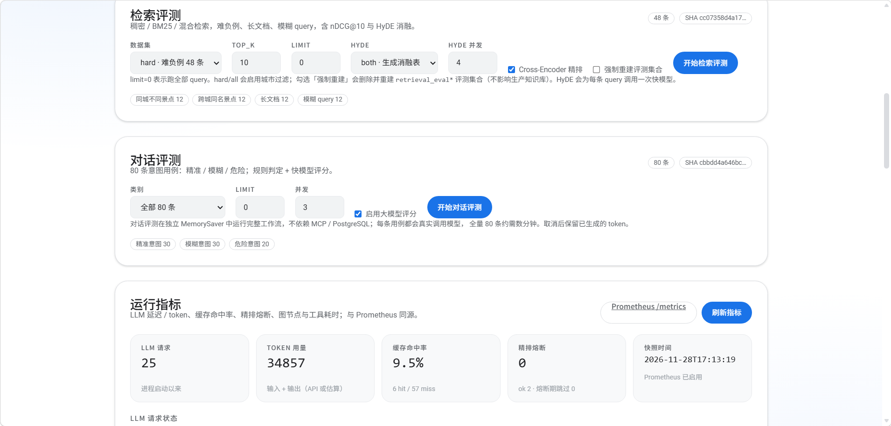 | 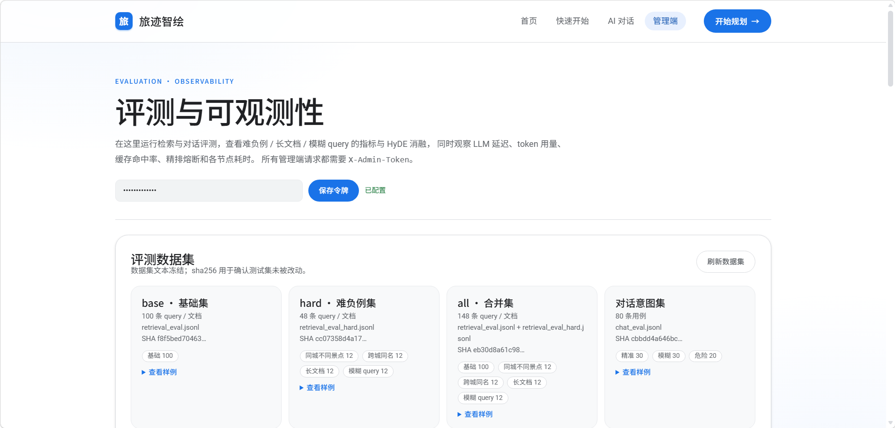 |

| 运行指标 · LLM / 缓存 / 节点耗时 | 节点、工具与 HTTP 明细 |
| :---: | :---: |
| 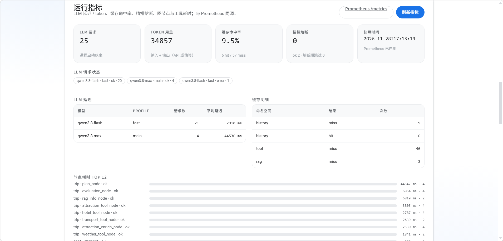 | 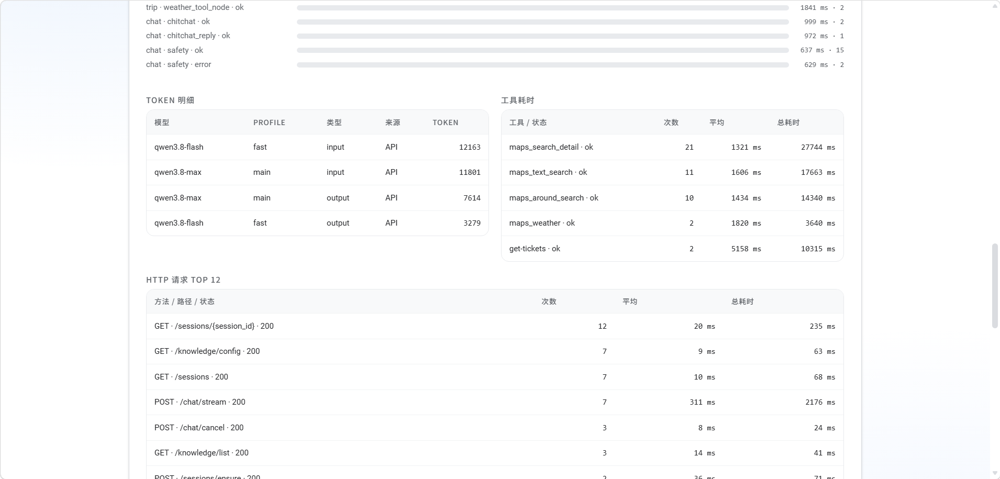 |

| 历史报告 · 报告列表 | 历史报告 · 对话评测详情 |
| :---: | :---: |
| 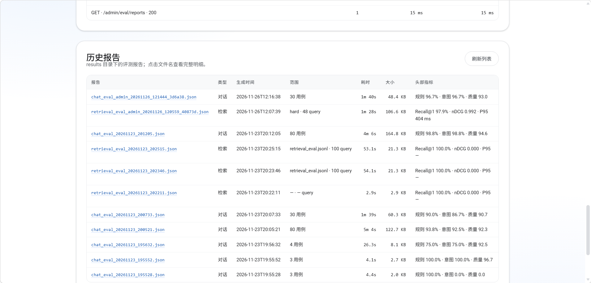 | 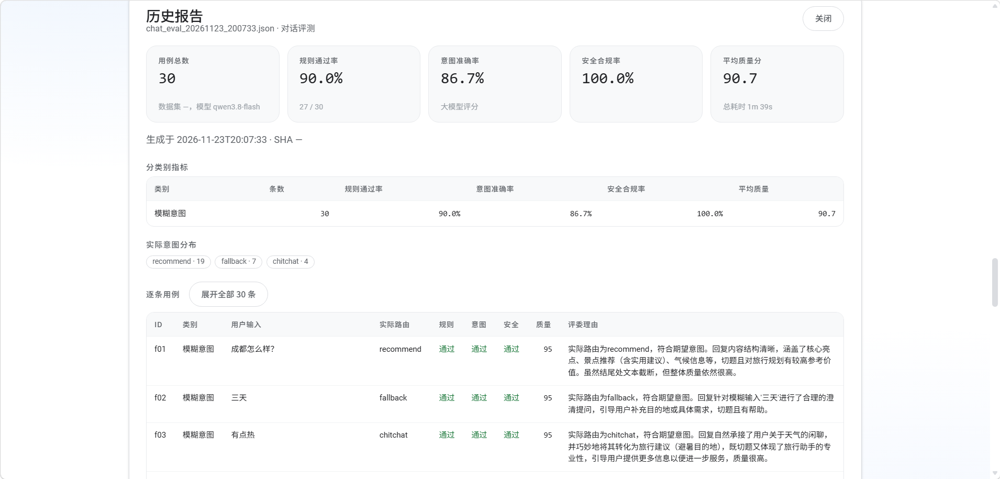 |

- **检索评测**：支持 `base / hard / all` 数据集、HyDE `off / on / both` 消融、精排开关与强制重建；报告展示 Recall@1/5、MRR@10、nDCG@10、P50/P95 延迟、调用量、按类型分组指标，以及跨城同名景点的城市过滤校验。
- **对话评测**：80 条意图用例，覆盖精准 / 模糊 / 危险请求，规则校验 + 大模型评分。
- **运行指标**：LLM 延迟 / token、缓存命中率、精排熔断、LangGraph 节点耗时、MCP / 知识库工具耗时；Prometheus 可在根路径 `/metrics` 抓取，管理端看板读取同源的进程内快照。
- **隔离执行**：管理端评测通过独立 Python 子进程复用评测 CLI，不在 API 进程内修改 Milvus 全局配置；同类型评测同时只允许一个任务。

```bash
# 检索评测（需 Milvus；base 100 / hard 48 / all 148）
python -m backend.app.evaluation.retrieval_eval --dataset all

# 对话评测（80 条意图用例）
python -m backend.app.evaluation.chat_eval
```

## 📁 项目结构

```text
travel_agents/
├── backend/app/
│   ├── main.py                      # FastAPI 入口：structlog / lifespan / 路由 / 异常
│   ├── core/
│   │   ├── config.py                # Settings 聚合根（按模块分组的内部类）
│   │   ├── logging.py               # structlog 配置与 get_logger
│   │   ├── database.py              # SQLAlchemy async + LangGraph checkpointer
│   │   ├── runtime.py               # Windows ProactorEventLoop 工厂
│   │   ├── metrics.py               # Prometheus 指标 + 进程内看板快照
│   │   ├── deps.py                  # get_db / 各 service 的 Depends
│   │   ├── exceptions.py            # AppError 体系
│   │   └── exception_handlers.py    # 全局 JSON 错误信封
│   ├── integrations/
│   │   ├── llm.py                   # LLM / Embedding 单例与指标回调
│   │   ├── milvus.py                # Milvus 集合 / 稠密+BM25 / 精排 / CRUD
│   │   ├── memory_milvus.py         # 长期记忆集合（user_memories）
│   │   ├── cache.py                 # Redis 缓存与工具结果包装
│   │   └── mcp.py                   # 高德 / 时间 / 12306 MCP 管理
│   ├── agent/
│   │   ├── graph.py                 # 行程规划 LangGraph 图定义（核心）
│   │   ├── state.py                 # PlannerState 状态定义与 reducer
│   │   ├── constants.py             # 节点文案 / 轮次 / 并发等常量
│   │   ├── prompts.py               # 各节点提示词
│   │   └── nodes/                   # attraction / hotel / weather / rag / plan ...
│   ├── modules/
│   │   ├── health/                  # 健康检查
│   │   ├── admin/                   # 管理端：评测运行 / 报告历史 / 指标快照
│   │   ├── sessions/                # 用户 / 会话（models/repository/service/router）
│   │   ├── chat/                    # 对话 SSE + checkpointer 历史
│   │   │   └── workflow/            # 意图路由 / 闲聊子图 / 工具循环 / 安全围栏
│   │   ├── memory/                  # 分层记忆：摘要 / 事实 / 任务状态 / 长期记忆
│   │   ├── knowledge/               # 知识库：解析 / Markdown 优化 / 父子块 / 混合检索 / ingest_cli
│   │   └── trip/                    # 行程规划 + 对话预填（models/repository/service/router/schemas）
│   ├── evaluation/                  # chat_eval / retrieval_eval + datasets + results
│   ├── scripts/                     # init_db.py / init_milvus.py
│   └── data/
│       ├── corpus/                  # 城市攻略语料（txt，11 城）
│       └── md5_milvus.text          # Milvus 入库 MD5 账本（运行时生成）
├── frontend/                        # Vue 3 + Vite 前端
│   ├── src/
│   │   ├── views/                   # Landing / QuickStart / Chat / Result / Admin
│   │   ├── components/
│   │   │   ├── site/                # 站点页头 / 页脚 / 纸张纹理 / 印章
│   │   │   ├── sketchbook/          # 翻书 Book / 表单 Form / 进度 Progress
│   │   │   ├── chat/                # 会话列表 / 消息 / 输入框 / 知识库抽屉
│   │   │   └── admin/               # 评测面板 / 指标看板 / 历史报告
│   │   ├── composables/             # usePaperTheme（纸张主题）
│   │   ├── assets/sketchbook/       # 11 城手绘插画
│   │   ├── data/                    # sketchbookCities（选城配置）
│   │   ├── services/api.ts          # /api/v1 接口与 SSE 消费
│   │   ├── services/admin.ts        # 管理端接口（X-Admin-Token）
│   │   ├── store.ts                 # 轻量 reactive store（userId / activeSession）
│   │   ├── styles/                  # 全局 / 站点 / 翻书 / 管理端样式
│   │   └── types/                   # TS 类型定义
│   └── .env                         # VITE_AMAP_WEB_JS_KEY
├── pic/                             # README 截图
├── requirements.txt
└── .env
```

## 🙏 致谢

- [LangGraph](https://github.com/langchain-ai/langgraph) — 多智能体编排框架
- [高德开放平台](https://lbs.amap.com/) — 地图与 MCP 服务
- [阿里云百炼](https://bailian.console.aliyun.com/) — 通义千问模型、Embedding 与 gte-rerank 精排服务
- [Milvus](https://milvus.io/) — 稠密 + BM25 稀疏向量混合检索
- [MinerU](https://github.com/opendatalab/MinerU) — PDF 版式解析与 OCR（云端 Precision API）
- [Threeui](https://threeui.com/) — 手账翻书 3D 动效
