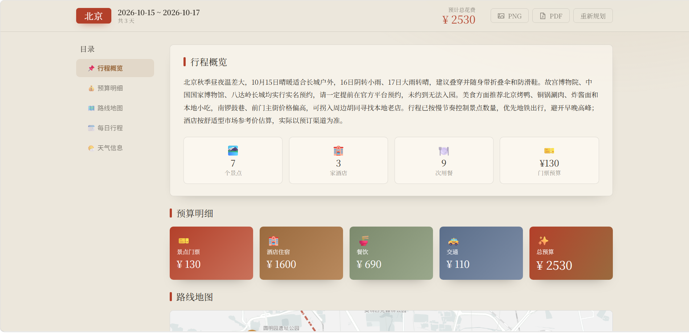
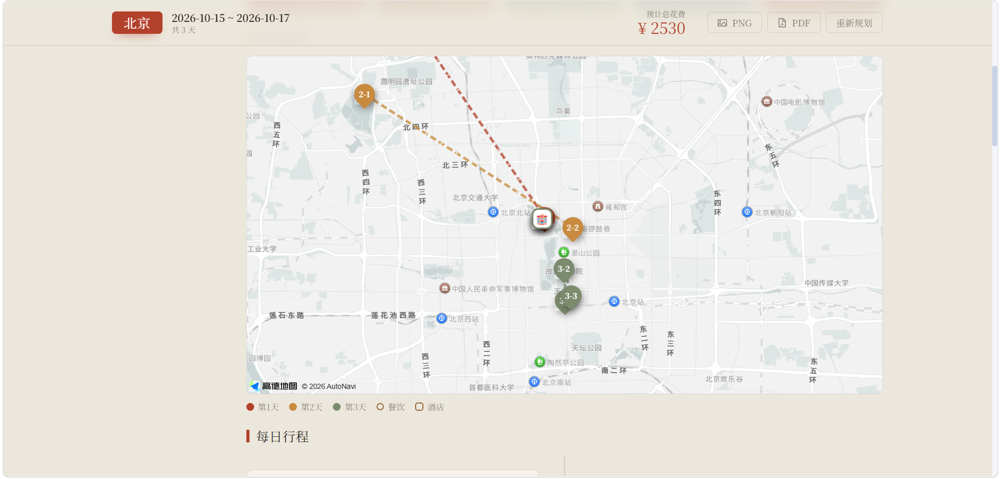
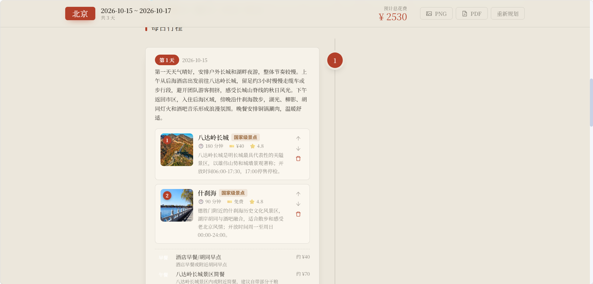
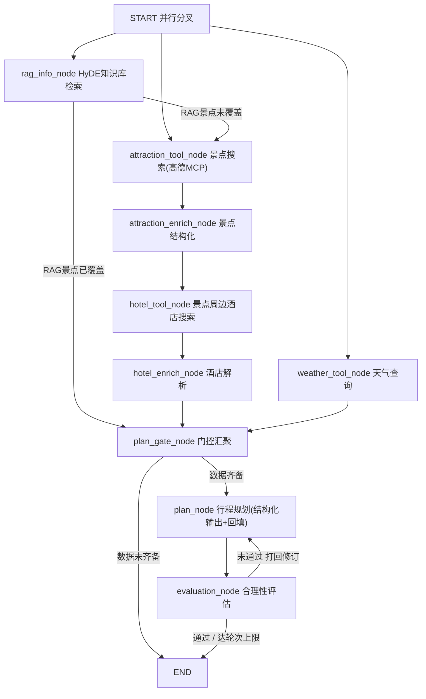

# 🧳 Travel-agents · 智能旅行助手

基于 **LangGraph 多智能体工作流** 的 AI 旅行规划系统：用户在手账翻书式首页选定城市、日期与偏好后，Agent 并行调用高德地图 MCP 工具与本地 RAG 知识库，获取真实景点 / 酒店 / 天气数据，经「规划 → 评估 → 反思修订」循环生成包含每日行程、餐饮、住宿、预算的完整旅行计划，并通过 SSE 实时推送各节点进度。

## 📸 界面预览

| 首页 · 手账选城 | 翻书动画 · 切换城市 |
| :---: | :---: |
|  |  |

| 翻到下一座城 | 规划进度 · SSE 实时反馈 |
| :---: | :---: |
|  |  |

| 规划结果 · 概览 / 预算 | 规划结果 · 路线地图 | 规划结果 · 每日行程 |
| :---: | :---: | :---: |
|  |  |  |

## ✨ 功能特性

**前端交互**
- **手账翻书式首页**：11 座城市（北京 / 上海 / 广州 / 杭州 / 西安 / 成都 / 重庆 / 长沙 / 青岛 / 厦门 / 南京）配手绘插画，纯 CSS 3D + `requestAnimationFrame` 弹簧动画实现真实翻页效果，支持拖拽 / 键盘 / 点击城市直达
- **SSE 实时进度**：规划过程中以「正在为你书写行程…」进度面板展示节点级进度、步骤打勾与日志流，心跳保活、断连自动取消
- **规划结果页**：行程概览、预算明细、路线地图（高德 JS API 2.0，景点/酒店/餐饮分色标注 + 当日景点连线）、每日行程时间线（景点可排序 / 删除）、天气信息
- **行程导出**：一键导出 PDF / PNG

**后端 Agent**
- **多源并行检索**：景点搜索、天气查询、RAG 知识库检索三路并行，景点详情并发拉取（信号量限流 + 自动重试）
- **HyDE 知识库检索**：LLM 先生成假设性答案文档再做向量检索，命中攻略类语料；检索出的必玩景点未被工具覆盖时自动触发**补搜循环**
- **真实数据锚点选酒店**：以景点坐标为锚点做周边 3km 酒店搜索，Haversine 公式计算「距景点约 X km」
- **门控汇聚**：`plan_gate_node` 统一汇聚三条并行分支，数据齐备才放行规划节点，避免中间态提前规划
- **评估反思循环**：评估节点做「确定性硬校验（天数 / 时长 / 路线衔接）+ LLM 合理性评估」，不合格打回规划节点修订，最多 2 轮
- **防幻觉设计**：LLM 只输出计划框架（名称引用），景点 / 酒店 / 天气 / 日期等详情由系统按名称确定性回填，空景点日兜底补填

## 🏗 系统架构



**关键设计**：
- **门控节点** `plan_gate_node`：三条并行分支全部汇聚到此，通过 `is_plan_ready()` 判定数据齐备（景点 / 酒店 / 天气 / RAG 均就绪且酒店轮次追上搜索轮次）后才放行规划，未齐备则本轮直接 END（剩余分支完成后会再次触发门控）
- 状态字段使用自定义 **reducer**（set 并集 / list 累积）支持多轮补搜数据叠加
- 关键节点（RAG / 规划 / 评估 / 景点结构化）配置 `RetryPolicy` 应对 LLM 偶发失败

## 🛠 技术栈

| 层 | 技术 |
|---|---|
| Agent 编排 | LangGraph 1.x、LangChain 1.x |
| 大模型 | LangChain `init_chat_model`（OpenAI 兼容接口，默认阿里云 DashScope 通义千问，可换任意兼容模型） |
| 工具接入 | 高德地图 MCP（SSE 传输） |
| RAG | SQLite-vec、HyDE、DashScope text-embedding |
| 后端 | FastAPI、Uvicorn、SSE（`astream_events`） |
| 前端 | Vue 3、Vite、TypeScript、Ant Design Vue、高德地图 JS API 2.0、jspdf / html2canvas、CSS 3D 翻书动效 |
| 可观测 | LangSmith 追踪（可选） |

## 🚀 快速开始

### 环境要求
- Python ≥ 3.11
- Node.js ≥ 18
- 高德开放平台 API Key（后端 MCP 与前端 Web JS Key）
- 阿里云百炼（DashScope）API Key

### 1. 克隆项目并安装后端依赖
```bash
git clone https://github.com/sheepsheep678/travel_agents.git
cd travel_agents
python -m venv .venv
# Windows
.venv\Scripts\activate
# macOS / Linux
# source .venv/bin/activate
pip install -r requirements.txt
```

### 2. 配置环境变量
在项目根目录创建 `.env`，按下表填写：

| 变量 | 说明 |
|---|---|
| `HOST` / `PORT` | 服务监听地址与端口，默认 `0.0.0.0` / `8000` |
| `LOG_LEVEL` | 日志级别，默认 `INFO` |
| `CORS_ORIGINS` | 允许的跨域来源，逗号分隔 |
| `OPENAI_API_KEY` | DashScope API Key（OpenAI 兼容模式） |
| `OPENAI_BASE_URL` | `https://dashscope.aliyuncs.com/compatible-mode/v1` |
| `OPENAI_MODEL_ID` | 模型 ID，如 `qwen3.7-max` |
| `OPENAI_TIMEOUT` | LLM 请求超时（秒），建议 ≥ `120` |
| `EMBEDDING_MODEL_NAME` | 向量模型，如 `text-embedding-v4` |
| `AMAP_API_KEY` | 高德开放平台 Key（后端 MCP 使用） |
| `VITE_AMAP_WEB_JS_KEY` | 高德 JS API Key（结果页地图），**写入 `frontend/.env`** |
| `UNSPLASH_ACCESS_KEY` / `UNSPLASH_SECRET_KEY` | Unsplash 图片服务（可选） |
| `LANGSMITH_TRACING` / `LANGSMITH_API_KEY` | LangSmith 追踪（可选） |

`.env` 模板：
```dotenv
HOST=0.0.0.0
PORT=8000
LOG_LEVEL=INFO
CORS_ORIGINS=http://localhost:5173,http://localhost:3000
OPENAI_API_KEY=sk-xxxx
OPENAI_BASE_URL=https://dashscope.aliyuncs.com/compatible-mode/v1
OPENAI_MODEL_ID=qwen3.7-max
OPENAI_TIMEOUT=120
EMBEDDING_MODEL_NAME=text-embedding-v4
AMAP_API_KEY=xxxx
UNSPLASH_ACCESS_KEY=
UNSPLASH_SECRET_KEY=
LANGSMITH_TRACING=false
LANGSMITH_API_KEY=
```

> 💡 向量库路径 `db_path` / `md5_path` 已按代码位置自动推导到 `backend/app/api/`（`vec.db` / `md5.text`），无需手动改绝对路径；如需自定义仍可通过同名环境变量覆盖。

### 3. 启动后端（项目根目录执行）
```bash
python -m backend.app.api.main
```
启动时会自动连接高德 MCP 并加载工具，默认监听 `8000` 端口。加 `--reload` 可热重载。

### 4. 启动前端
```bash
cd frontend
npm install
npm run dev
```
访问 `http://localhost:5173` 即可使用。

## 🔌 API 说明

| 方法 | 路径 | 说明 |
|---|---|---|
| GET | `/api/health` | 健康检查（含 MCP 就绪状态） |
| POST | `/api/trip/plan` | 一次性生成旅行计划 |
| POST | `/api/trip/plan/stream` | SSE 流式生成，实时推送节点进度 |

**请求体示例**：
```json
{
  "city": "青岛",
  "start_date": "2026-08-20",
  "end_date": "2026-08-22",
  "travel_days": 3,
  "transportation": "自驾",
  "accommodation": "酒店",
  "preferences": ["风景", "啤酒"],
  "free_text_input": "希望旅行氛围浪漫、轻松、慢节奏"
}
```

**SSE 事件协议**：
```jsonc
{"type": "node_start", "node": "weather_tool_node", "label": "正在查询天气..."}
{"type": "node_end",   "node": "weather_tool_node", "payload": {"weather_count": 4}}
{"type": "node_end",   "node": "evaluation_node",   "payload": {"passed": true, "round": 1}}
{"type": "node_error", "node": "plan_node", "message": "...", "retry": true}
{"type": "done", "success": true, "message": "生成成功", "data": {"...": "TripPlan"}}
```

## 📚 RAG 知识库

11 座城市的攻略语料位于 `backend/app/api/data/*.txt`，向量化后存入 `vec.db`（表名 `knowledge_base`）。新增或更新语料后重建向量库：

```bash
# 脚本会按自身位置自动定位 data 目录，在项目根目录执行即可
python -m backend.app.api.rag_file_uploader
```

上传脚本按文件 MD5 去重，已入库文件自动跳过；切分策略为 500 字符 / 50 字符重叠，按中文标点优先断句。

## 📁 项目结构

```
travel_agents/
├── backend/app/
│   ├── api/
│   │   ├── data/                  # 城市攻略语料（txt，11 城）
│   │   ├── main.py                # FastAPI 入口（健康检查/规划/流式规划）
│   │   ├── rag_file_uploader.py   # 知识库向量化上传脚本
│   │   ├── vec.db                 # SQLite-vec 向量库
│   │   └── md5.text               # 已入库文件 MD5 去重记录
│   ├── models/
│   │   ├── request.py             # TripRequest
│   │   └── response.py            # TripPlan / Attraction / Hotel / Weather 等
│   ├── nodes/
│   │   ├── attraction.py          # 景点搜索 + 结构化
│   │   ├── hotel.py               # 酒店搜索 + 解析
│   │   ├── weather.py             # 天气查询
│   │   ├── rag.py                 # HyDE 知识库检索
│   │   ├── plan.py                # 行程规划（结构化输出 + 确定性回填）
│   │   ├── evaluation.py          # 评估反思（硬校验 + LLM 评估）
│   │   ├── gate.py                # 门控汇聚 / 路由
│   │   ├── llm.py                 # LLM / Embedding 单例
│   │   ├── utils.py               # MCP 结果解析 / 距离 / 日期工具
│   │   └── tools/
│   │       └── amap_mcp_servers.py    # 高德 MCP 客户端（SSE）
│   ├── services/
│   │   ├── config.py              # pydantic-settings 配置
│   │   ├── rag_component.py       # SQLite-vec 异步检索
│   │   └── travel_plan_agent.py   # LangGraph 图定义（核心）
│   ├── state.py                   # PlannerState 状态定义与 reducer
│   ├── constants.py               # 节点文案 / 轮次 / 并发等常量
│   └── prompts.py                 # 各节点提示词
├── frontend/                      # Vue3 + Vite 前端
│   └── src/
│       ├── views/                 # Home（手账选城）/ Result（结果页）
│       ├── components/sketchbook/ # 翻书 Book / 表单 Form / 进度 Progress
│       ├── assets/sketchbook/     # 11 城手绘插画
│       ├── data/                  # sketchbookCities（选城配置）
│       ├── services/api.ts        # 后端接口与 SSE 消费
│       ├── store.ts               # Pinia 状态（跨页传递计划）
│       └── types/                 # TS 类型定义
├── pic/                           # README 截图
├── requirements.txt
└── .env
```

## 🙏 致谢
- [LangGraph](https://github.com/langchain-ai/langgraph) — 多智能体编排框架
- [高德开放平台](https://lbs.amap.com/) — 地图与 MCP 服务
- [阿里云百炼](https://bailian.console.aliyun.com/) — 通义千问模型服务
- [Threeui](https://threeui.com/) — 手账翻书 3D 动效
